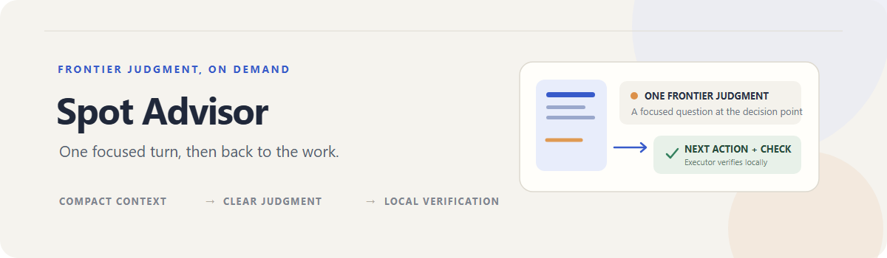
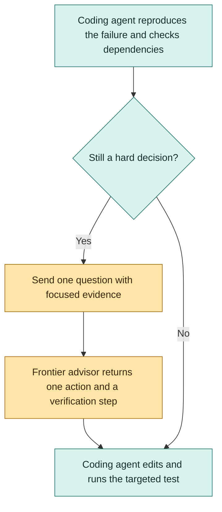
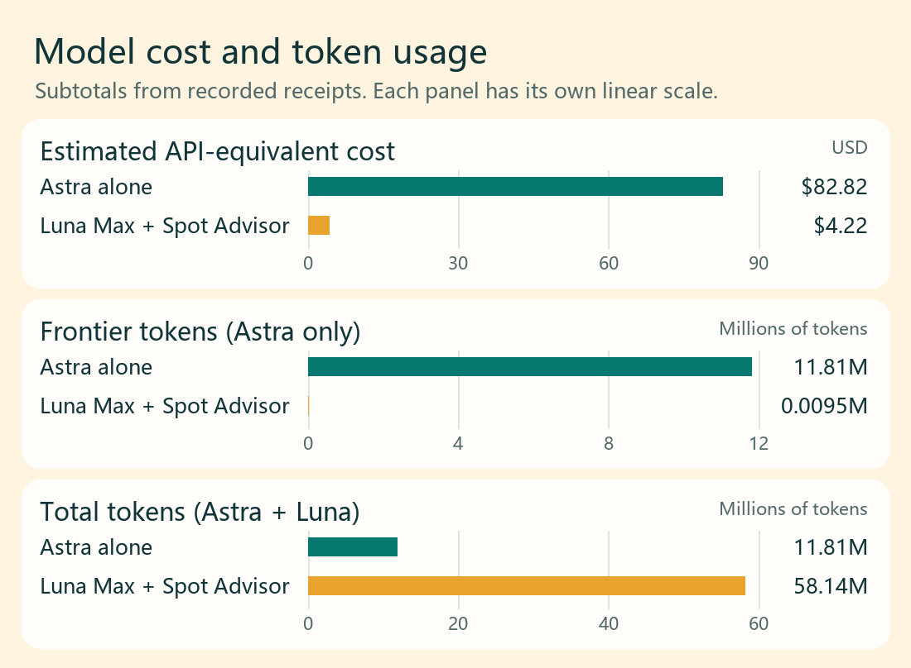

<p align="center">
  
</p>

<h1 align="center">Spot Advisor</h1>

<p align="center"><strong>Save frontier tokens for the decisions that need them.</strong></p>

<p align="center">
  <strong>English</strong> · <a href="README.zh-CN.md">简体中文</a><br>
  <a href="docs/install.md">🚀 Install</a> ·
  <a href="paper/spot-advisor-preprint.pdf">📄 arXiv draft (PDF)</a> ·
  <a href="eval/README.md">📊 Evaluation</a>
</p>

Spot Advisor is a skill for coding agents. Let a lower-cost model investigate, edit, and test in your current session. When it hits a hard decision, it sends a frontier model one question with the relevant evidence. The reply gives your agent a next step and a check it can run.

## 🐾 How it saves frontier tokens

A frontier model doing the whole repair spends its own tokens on exploration, tool output, edits, and test retries. With Spot Advisor, your coding agent handles those steps. The frontier model receives a short packet with the decision, constraints, and evidence. If your agent can resolve the issue itself, it can skip the call.



The advisor works from the packet without repository tools. You can preview exactly what is sent. Your coding agent stays in charge of the patch and its verification.

## 🚀 Try it offline

With Git and Python installed, clone the repository and run the preview. If you already have the checkout, run the last line from its root.

```sh
git clone https://github.com/stancsz/spot-advisor.git
cd spot-advisor
python skills/advisor/scripts/ask_expert.py --preview --protocol v2 --question "A config test expects False but gets the default. The code uses overrides.get(name) or defaults[name]. What should I change and how should I check it?"
```

Read the `packet` field to see the question, constraints, and verification target. The preview makes zero model calls and needs no account or API key.

### 💬 What one consultation looks like

An explicit `False` falls through to the default. Here is a condensed reply from a live consultation.

| Reply field | What the coding agent gets |
| --- | --- |
| **Verdict** | Check whether the key exists. A false value can be an explicit override. |
| **Do** | Use `overrides[name] if name in overrides else defaults[name]`. |
| **Verify** | Check that `False`, `0`, and `""` survive and a missing key uses the default. |
| **Risk** | An explicit `None` will also survive. Check how callers use it. |

### ⚡ Make your first live call

[Install the skill](docs/install.md) in Codex, Claude Code, or a compatible agent host. Then give your agent a concrete decision.

> Use Spot Advisor on this failing test. Confirm the intended assertion ran. If two plausible fixes remain, preview a short packet with the failure and the two options. Ask one question that would change your next edit, then verify the advice locally.

Text consultations can use a signed-in Codex or Claude CLI. A compatible gateway can also handle image consultations with a vision-capable route. Check the [transport requirements](docs/install.md#3-transport-setup---transport) for your setup.

## 📊 Cost and token use

Across 48 public repair tasks, the recorded requests that could be priced came to **$82.82 for Astra alone** and **$4.22 for Luna Max with Spot Advisor**. The advice workflow recorded far fewer Astra tokens and more tokens overall. A higher total token count can still cost less when most of those tokens come from a lower-cost model.



| Public repair study | Astra alone | Luna Max + Spot Advisor |
| --- | ---: | ---: |
| Estimated API-equivalent cost of priceable requests (USD) | $82.82 | $4.22 |
| Recorded frontier tokens (millions) | 11.81 | 0.0095 |
| Recorded total tokens (millions) | 11.81 | 58.14 |
| Independently graded passes | 39 / 48 | 39 / 48 |
| Passes graded within 15 minutes | 39 / 48 | 31 / 48 |
| Tasks with complete usage receipts | 44 / 48 | 40 / 48 |

The cost estimates apply the study’s November 20, 2026 API rates to recorded input, cached input, cache writes, and output. These are estimates for subscription-run requests with priceable usage. Four requests in the Astra-only workflow and eight in the Spot Advisor workflow could not be priced, so full-run costs and net savings remain unresolved. [Study rate card](eval/pricing.json) · [Request receipts](eval/results/2026-11-20/formal-collection/evidence.jsonl)

Astra finished grading sooner on all 36 issues both workflows passed. The study could not establish comparable repair quality within its prespecified margin. [Recorded metrics](eval/results/2026-11-20/formal-collection/metrics.json) · [Run manifest](eval/results/2026-11-20/formal-collection/manifest.json) · [Timing audit](eval/results/2026-11-20/formal-collection/delivery.json) · [Chart generator](eval/render_readme_charts.py)

## 📄 Paper & replication

**Stan Chen** · *Frontier Advice or Frontier Execution? Time to verification and patch changes in paired software repairs*

[Read the arXiv draft (repository PDF)](paper/spot-advisor-preprint.pdf) · [Research and reproduction](paper/README.md) · [Study protocol](docs/research-protocol.md) · [Cite the software](CITATION.cff)

The PDF is the repository’s working draft for arXiv. The [roadmap](ROADMAP.md) tracks follow-up experiments on when to ask for advice, how to frame the question, and what it costs per verified repair.

[Skill source](skills/advisor/SKILL.md) · [MIT license](LICENSE)
