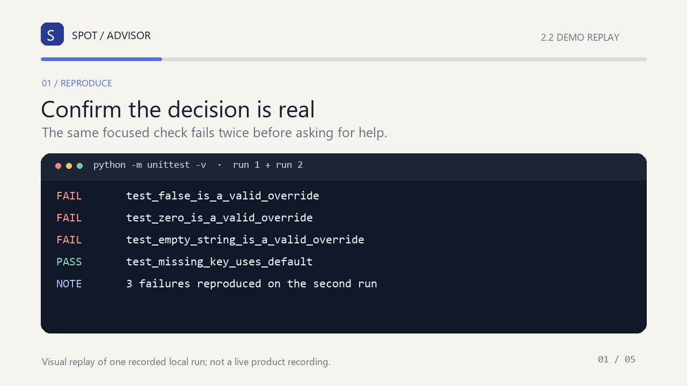

  

<h1 align="center">Spot Advisor 2.2</h1>

<strong>Frontier judgment on demand. Then back to the work.</strong>

  <strong>English</strong> · <a href="README.zh-CN.md">简体中文</a> 
  <a href="https://spot-advisor.github.io/">Official site</a> ·
  <a href="#try-it-offline">Try the offline preview</a> ·
  <a href="demo/README.md">Run the terminal demo</a> ·
  <a href="docs/install.md">Install</a> ·
  <a href="#research-and-paper">Research and paper</a>

Spot Advisor is a skill for coding agents. It guides your coding agent to prepare a compact, reviewable question for a frontier model when a real decision remains. The advisor returns a recommendation and a way to check it; your coding agent keeps control of the edits and local verification.

**Install:** <code>npx skills add spot-advisor/spot-advisor --skill advisor</code> · **Try first:** [offline preview](#try-it-offline) · **Walk through the full example:** [terminal demo](demo/README.md)

## When to use it

Ask when the intended check ran and its dependencies are available, but the evidence still leaves materially different next actions. The skill also allows an ask after the same targeted check fails twice. If a quick local probe can distinguish the options, run it first. A consultation should change a decision, not repeat work the executor can already verify.

## How the workflow fits together

~~~mermaid
flowchart TB
    A["Coding agent reproduces the issue and checks dependencies"] --> B{"Can a local check settle the next move?"}
    B -->|Yes| F["Continue locally and verify"]
    B -->|No| C["Preview compact evidence and ask one focused question"]
    C --> D["Frontier advisor returns a judgment and a check"]
    D --> F
    classDef executor fill:#e8f1e9,stroke:#35815f,color:#274c3b
    classDef advisor fill:#e8edfb,stroke:#385bca,color:#20283a
    class A,B,F executor
    class C,D advisor
~~~

The skill does not inspect your repository on its own. Your coding agent selects the evidence, and you can preview the exact packet before sending it. The advisor answers from that packet without repository tools.

## Try it offline

With Git and Python installed, clone the repository and run the preview. If you already have the checkout, run the last line from its root.

~~~sh
git clone https://github.com/spot-advisor/spot-advisor.git
cd spot-advisor
python skills/advisor/scripts/ask_expert.py --preview --protocol v2 --question "A config test expects False but gets the default. The code uses overrides.get(name) or defaults[name]. What should I change and how should I check it?"
~~~

Read the <code>packet</code> field to see the question, constraints, and verification target. The preview runs locally, makes zero model calls, and needs no account or API key.

## See one consultation

A configuration explicitly sets <code>False</code>, but the code returns the default. Here is a condensed reply from a live consultation.

| Reply field | What the coding agent gets |
| --- | --- |
| **Verdict** | Check whether the key exists. A false value can be an explicit override. |
| **Do** | Use <code>overrides[name] if name in overrides else defaults[name]</code>. |
| **Verify** | Check that <code>False</code>, <code>0</code>, and <code>""</code> survive, and a missing key uses the default. |
| **Risk** | An explicit <code>None</code> will also survive. Check how callers use it. |

That answer gives the executor a specific edit and targeted checks, while surfacing a contract question about <code>None</code>.

## Make your first live call

[Install the skill](docs/install.md) in Codex, Claude Code, or another supported host. Give your coding agent a concrete decision:

> Use Spot Advisor on this failing test. Confirm the intended assertion ran and its dependencies are available. If two plausible next steps remain after local checks, preview a short packet with the failure and both options. Ask one question that would change your next edit, then verify the recommendation locally.

- **Codex** can use an existing Codex login for text consultations.
- **Claude Code** can use its signed-in local CLI for text consultations.
- **Compatible gateways** support text and, on a vision-capable route, image consultations.

See the [transport and credential requirements](docs/install.md#3-transport-setup---transport) for setup details. The executor remains responsible for implementation and verification.

## Research: tokens, price estimates, and verification

The public repair study compares Astra acting alone with Luna Max using Spot Advisor across 48 assignments. Both workflows had 39 independently graded passes out of 48. Within 15 minutes, Astra passed 39 and Spot Advisor passed 31. The study did not establish comparable repair quality within its prespecified margin.

For requests with priceable usage receipts, the estimated API-equivalent cost was **$82.82 for Astra alone** and **$4.22 for Luna Max with Spot Advisor**. Spot Advisor recorded far fewer frontier-model tokens but more total tokens, because most execution tokens came from Luna Max.

| Public repair study | Astra alone | Luna Max + Spot Advisor |
| --- | ---: | ---: |
| Estimated API-equivalent cost of priceable requests (USD) | $82.82 | $4.22 |
| Recorded frontier tokens (millions) | 11.81 | 0.0095 |
| Recorded total tokens (millions) | 11.81 | 58.14 |
| Independently graded passes | 39 / 48 | 39 / 48 |
| Passes graded within 15 minutes | 39 / 48 | 31 / 48 |
| Tasks with complete usage receipts | 44 / 48 | 40 / 48 |

The estimates apply the study’s November 20, 2026 API rates to recorded input, cache reads, cache writes, and output. Four Astra-only requests and eight Spot Advisor requests could not be priced. These results describe priceable requests; full-run cost, net savings, and equivalent repair quality remain unresolved. [Study rate card](eval/pricing.json) · [Request receipts](eval/results/2026-11-20/formal-collection/evidence.jsonl)

Astra completed grading sooner on all 36 issues both workflows passed. The study results and limitations are in the [recorded metrics](eval/results/2026-11-20/formal-collection/metrics.json), [run manifest](eval/results/2026-11-20/formal-collection/manifest.json), and [timing audit](eval/results/2026-11-20/formal-collection/delivery.json). The [chart generator](eval/render_readme_charts.py) rebuilds the comparison graphic.

## Research and paper

**Stan Chen** · *Frontier Advice or Frontier Execution? Time to verification and patch changes in paired software repairs*

[Read the arXiv draft (PDF)](paper/spot-advisor-preprint.pdf) · [Research and reproduction](paper/README.md) · [Study protocol](docs/research-protocol.md) · [Cite the software](CITATION.cff)

The repository PDF is the current manuscript draft. The [roadmap](ROADMAP.md) tracks follow-up experiments on when to ask, how to frame a useful question, and cost per independently verified repair. The skill and its source are available under the [MIT license](LICENSE).
