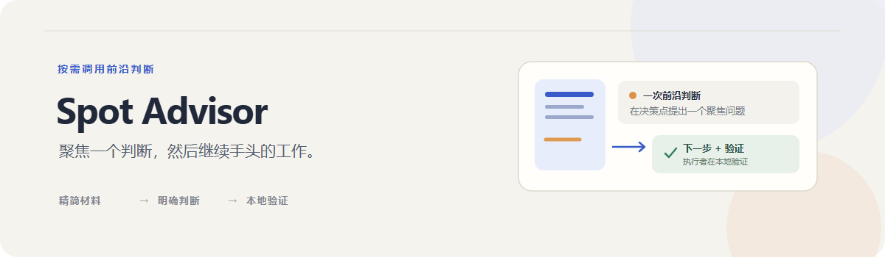
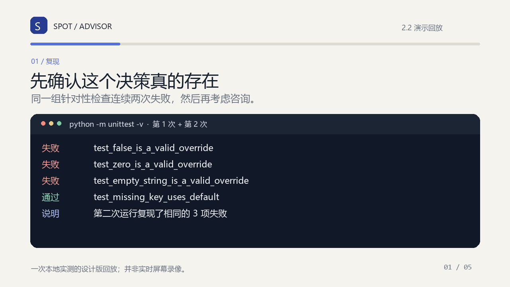
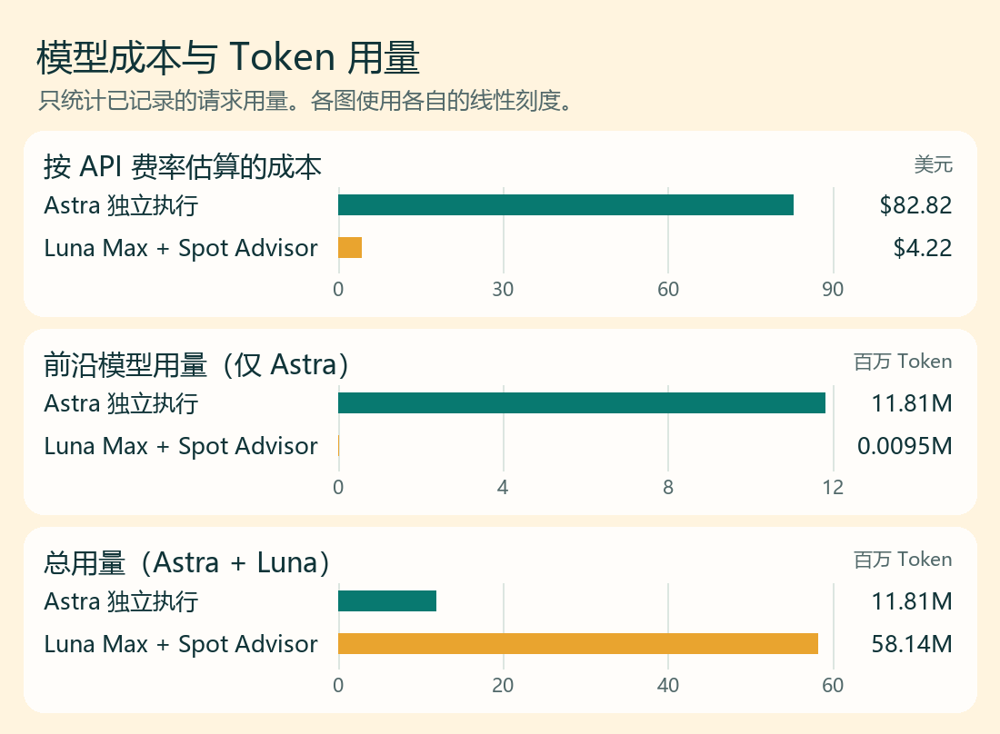

  

<h1 align="center">Spot Advisor 2.4</h1>

<strong>按需调用前沿判断，然后继续手头的工作。</strong>

  <a href="README.md">English</a> · <strong>简体中文</strong> 
  <a href="https://spot-advisor.github.io/">官方网站</a> ·
  <a href="docs/market-position.md">市场定位与成熟度</a> ·
  <a href="#离线试一试">离线预览</a> ·
  <a href="demo/README.md">终端演示</a> ·
  <a href="docs/install.md">安装</a> ·
  <a href="#研究与论文">研究与论文</a>

Spot Advisor 是面向编程智能体的技能。它会引导当前智能体整理一份精简、可检查的问题材料，在确有判断分岔时向前沿模型咨询。顾问根据材料给出建议和验证方法；修改代码、运行本地检查仍由当前智能体负责。

2.4 支持按范围提交文本、图表图片和原始 PCM WAV 语音。运行已安装脚本的 `--doctor` 可查看实际版本和后端配置。[首次使用指南](docs/first-consultation-24.md) · [发布验收记录](docs/release-2.4.md)

**安装：**<code>npx skills add spot-advisor/spot-advisor --skill advisor</code> · **先试用：**[离线预览](#离线试一试) · **完整走一遍：**[终端演示](demo/README.md)

## 什么时候值得问

先确认目标检查确实运行，相关依赖也可用。如果证据仍对应着会导致不同修改的下一步，或同一个针对性检查已经连续失败两次，就可以考虑咨询。如果一个快速的本地检查足以区分方案，先做检查。咨询应该帮助执行者作出新的判断，而不是重复它已经能够验证的工作。

## 工作流程

~~~mermaid
flowchart TB
    A["编程智能体复现问题并检查依赖"] --> B{"本地检查能决定下一步吗？"}
    B -->|能| F["继续本地处理并验证"]
    B -->|不能| C["预览精简材料，提出一个聚焦问题"]
    C --> D["前沿顾问返回判断和验证方法"]
    D --> F
    classDef executor fill:#e8f1e9,stroke:#35815f,color:#274c3b
    classDef advisor fill:#e8edfb,stroke:#385bca,color:#20283a
    class A,B,F executor
    class C,D advisor
~~~

这项技能不会自行读取仓库。编程智能体会选择要发送的证据，你可以在发送前预览完整材料。顾问只依据这份材料作答，不会调用仓库工具。

## 离线试一试

装好 Git 和 Python 后，克隆仓库并运行预览。如果已经克隆过，在仓库根目录运行最后一行即可。

~~~sh
git clone https://github.com/spot-advisor/spot-advisor.git
cd spot-advisor
python skills/advisor/scripts/ask_expert.py --preview --protocol v2 --question "配置测试期望得到 False，却读到了默认值。代码使用 overrides.get(name) or defaults[name]。该怎么改，怎么验证？"
~~~

输出里的 <code>packet</code> 字段会显示问题、约束和验证目标。预览在本地运行，不会调用模型，也不需要账号或 API 密钥。

## 一次咨询会返回什么

配置明确设成了 <code>False</code>，代码却返回默认值。下面是一次真实咨询的回复摘要。

| 回复字段 | 给编程智能体的建议 |
| --- | --- |
| **Verdict（判断）** | 检查键是否存在。假值也可能是明确设置的覆盖值。 |
| **Do（行动）** | 使用 <code>overrides[name] if name in overrides else defaults[name]</code>。 |
| **Verify（验证）** | 确认 <code>False</code>、<code>0</code> 和 <code>""</code> 都能保留，缺少键时才取默认值。 |
| **Risk（风险）** | 显式传入的 <code>None</code> 也会保留。检查调用方如何使用它。 |

执行者拿到的是明确的改法和针对性检查，也能看到关于 <code>None</code> 契约的风险提示。

## 发起第一次真实咨询

在 Codex、Claude Code 或其他兼容环境中[安装技能](docs/install.md)，再给编程智能体一个具体的决策点：

> 用 Spot Advisor 看一下这个失败的测试。先确认目标断言确实执行、相关依赖可用。如果本地检查后仍有两个不同的合理下一步，预览包含失败信息和两种方案的精简材料。只问一个会影响下一次修改的问题，然后在本地验证建议。

- **Codex** 可以使用现有的 Codex 登录发起文本咨询。
- **Claude Code** 可以通过已登录的本地 CLI 发起文本咨询。
- **兼容网关**可以处理文本；如果路由支持视觉输入，也可以咨询图片。

配置详情见[连接方式与凭据要求](docs/install.md#3-transport-setup---transport)。修改代码和验证仍由执行者负责。

## 研究：Token、价格估算与验证结果

公开修复研究在 48 个任务上比较 Astra 独立执行与 Luna Max 搭配 Spot Advisor。两组都通过了 39 / 48 个独立评测。15 分钟内，Astra 通过 39 个，Spot Advisor 方案通过 31 个。研究尚未证实两组修复质量差异落在预先设定的范围内。

只看用量回执足以估算价格的请求，Astra 独立执行折合 **82.82 美元**，Luna Max 搭配 Spot Advisor 折合 **4.22 美元**。Spot Advisor 方案记录到的前沿模型 Token 少得多，但总 Token 更多，因为大部分执行用量来自 Luna Max。

| 公开修复研究 | Astra 独立执行 | Luna Max + Spot Advisor |
| --- | ---: | ---: |
| 可计价请求折合的 API 成本（美元） | $82.82 | $4.22 |
| 已记录的前沿模型用量（百万 Token） | 11.81 | 0.0095 |
| 已记录的总用量（百万 Token） | 11.81 | 58.14 |
| 通过独立评测 | 39 / 48 | 39 / 48 |
| 15 分钟内通过评测 | 39 / 48 | 31 / 48 |
| 用量回执完整的任务 | 44 / 48 | 40 / 48 |

价格估算采用研究记录的 2026 年 11 月 20 日 API 费率，分别计算普通输入、缓存读取、缓存写入和输出。Astra 独立执行有 4 个请求无法计价，Spot Advisor 方案有 8 个，因此这些数字只代表可计价请求，无法确定整轮成本或净节省，也还没有证实两组修复质量相当。[研究费率表](eval/pricing.json) · [请求回执](eval/results/2026-11-20/formal-collection/evidence.jsonl)

两组都通过的 36 个任务中，Astra 均更早完成评测。详细结果见[记录指标](eval/results/2026-11-20/formal-collection/metrics.json)、[运行清单](eval/results/2026-11-20/formal-collection/manifest.json)和[用时核查](eval/results/2026-11-20/formal-collection/delivery.json)。[图表生成脚本](eval/render_readme_charts.py)可以重新生成对比图。

## 产品与研究价值

- **用户掌控：**执行者选择证据、决定是否咨询、应用建议并验证工作。
- **聚焦干预：**只有本地检查仍留下实际决策分岔时才咨询。
- **结果可检查：**先预览问题材料，并要求建议附有可执行的验证方法。
- **证据可复现：**每个量化说法都对应仓库内的评测资料。
- **限制说清楚：**分别报告任务质量、耗时、前沿模型 Token、总 Token 和可计价成本，并保留缺失回执。

[市场定位与成熟度](docs/market-position.md) · [官方网站](https://spot-advisor.github.io/)

## 研究与论文

2.4 研究在配对任务上比较完整记录、自由摘要和结构化交接包。[2.4 论文源码与复现](paper/compression24/README.md)

早期配对修复研究由 **Stan Chen** 撰写，题为 *Frontier Advice or Frontier Execution?*

[阅读 arXiv 论文草稿（PDF）](paper/spot-advisor-preprint.pdf) · [研究与复现](paper/README.md) · [实验方案](docs/research-protocol.md) · [引用软件](CITATION.cff)

上面的 PDF 对应早期修复研究。[2.4 证据包](paper/compression24/README.md)对应本次多模态发布。软件使用 [MIT 许可证](LICENSE)。
