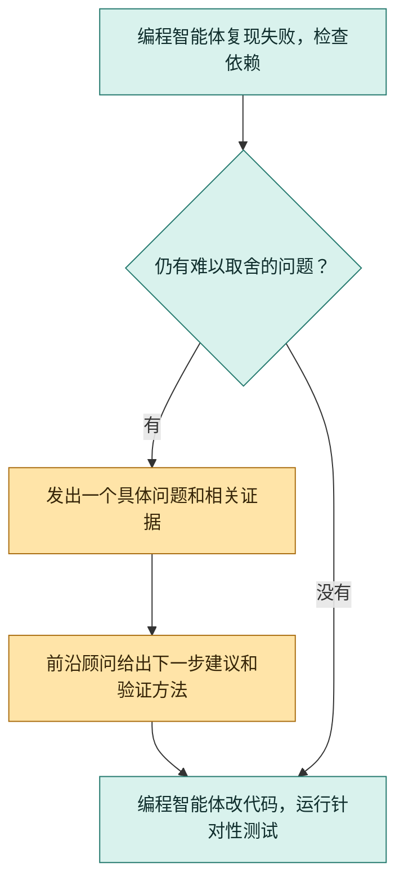

<p align="center">
  
</p>

<h1 align="center">Spot Advisor</h1>

<p align="center"><strong>把前沿模型的 Token 留给真正棘手的判断。</strong></p>

<p align="center">
  <a href="README.md">English</a> · <strong>简体中文</strong><br>
  <a href="docs/install.md">🚀 安装</a> ·
  <a href="paper/spot-advisor-preprint.pdf">📄 arXiv 论文草稿（PDF）</a> ·
  <a href="eval/README.md">📊 评测</a>
</p>

Spot Advisor 是一项给编程智能体用的技能。让成本更低的模型在当前会话里排查、改代码、跑测试。遇到难以取舍的问题时，再带着相关证据向前沿模型问一个具体问题，拿回下一步建议和一项可执行的验证。

## 🐾 怎样省前沿模型的 Token

如果整项修复都由前沿模型来做，排查、工具输出、改代码和反复跑测试都会消耗它的 Token。使用 Spot Advisor 后，这些步骤由当前的编程智能体完成。前沿模型只接收一份简短的材料，里面有待决问题、约束和关键证据。能自行解决的问题就可以跳过咨询。



发送前可以预览材料的完整内容。顾问根据这份材料作答，不会调用仓库工具。改代码和验证仍由当前的编程智能体负责。

## 🚀 离线试一试

装好 Git 和 Python 后，克隆仓库并运行预览。如果已经克隆过，在仓库根目录运行最后一行即可。

```sh
git clone https://github.com/stancsz/spot-advisor.git
cd spot-advisor
python skills/advisor/scripts/ask_expert.py --preview --protocol v2 --question "配置测试期望得到 False，却读到了默认值。代码用了 overrides.get(name) or defaults[name]。该怎么改、怎么验证？"
```

输出里的 `packet` 字段会显示待决问题、约束和验证目标。预览在本地运行，无需调用模型，也不需要账号或 API 密钥。

### 💬 一次咨询会返回什么

配置明确设成了 `False`，代码却返回了默认值。下面是一次实际咨询的回复摘要。

| 回复字段 | 给编程智能体的建议 |
| --- | --- |
| **Verdict（判断）** | 检查键是否存在。假值也可能是明确设置的覆盖值。 |
| **Do（行动）** | 使用 `overrides[name] if name in overrides else defaults[name]`。 |
| **Verify（验证）** | 确认 `False`、`0` 和 `""` 都能保留，缺少键时才取默认值。 |
| **Risk（风险）** | 显式传入的 `None` 也会保留。检查调用方如何使用它。 |

### ⚡ 发起第一次咨询

在 Codex、Claude Code 或兼容的智能体环境里[安装技能](docs/install.md)，再给智能体一个具体问题。

> 用 Spot Advisor 看一下这个失败的测试。先确认目标断言确实执行了。如果还有两个都说得通的修法，就整理失败信息和两种方案，预览准备发送的内容。只问一个会影响下一次修改的问题，然后在本地验证建议。

文本咨询可以使用已登录的 Codex 或 Claude CLI。配置支持视觉输入的模型后，也可以通过兼容网关发起图片咨询。详见[连接方式与配置要求](docs/install.md#3-transport-setup---transport)。

## 📊 成本与 Token 用量

在 48 个公开修复任务中，仅统计可计价的请求，**Astra 独立执行折合 82.82 美元，Luna Max 搭配 Spot Advisor 折合 4.22 美元**。咨询方案记录到的 Astra Token 少得多，Token 总量却更高。只要大部分 Token 来自费率更低的模型，总用量更高也可能更省钱。


| 公开修复任务 | Astra 独立执行 | Luna Max + Spot Advisor |
| --- | ---: | ---: |
| 可计价请求折合的 API 成本（美元） | $82.82 | $4.22 |
| 已记录的前沿模型用量（百万 Token） | 11.81 | 0.0095 |
| 已记录的总用量（百万 Token） | 11.81 | 58.14 |
| 通过独立评测 | 39 / 48 | 39 / 48 |
| 15 分钟内通过评测 | 39 / 48 | 31 / 48 |
| 用量回执完整的任务 | 44 / 48 | 40 / 48 |

实验通过订阅运行。表中的美元金额按研究记录的 2026 年 11 月 20 日 API 费率折算，分别计入了输入、缓存读取、缓存写入和输出。Astra 独立执行有 4 个请求无法计价，Spot Advisor 方案有 8 个，因此还无法确定整轮实验的成本和实际节省金额。[研究费率表](eval/pricing.json) · [请求回执](eval/results/2026-11-20/formal-collection/evidence.jsonl)

两组都通过的 36 个任务中，Astra 独立执行均更早完成评测。研究尚未证实两组的修复质量差异落在预先设定的允许范围内。[记录指标](eval/results/2026-11-20/formal-collection/metrics.json) · [运行清单](eval/results/2026-11-20/formal-collection/manifest.json) · [用时核查](eval/results/2026-11-20/formal-collection/delivery.json) · [图表生成脚本](eval/render_readme_charts.py)

## 📄 论文与复现

**Stan Chen** · *Frontier Advice or Frontier Execution? Time to verification and patch changes in paired software repairs*

[阅读 arXiv 草稿（仓库内 PDF）](paper/spot-advisor-preprint.pdf) · [研究与复现](paper/README.md) · [实验方案](docs/research-protocol.md) · [引用软件](CITATION.cff)

这份 PDF 是为 arXiv 准备的工作稿。[路线图](ROADMAP.md)记录了后续要研究的问题：什么时候值得问、怎么问，以及每项通过验证的修复实际花费多少。

[技能源码](skills/advisor/SKILL.md) · [MIT 许可证](LICENSE)
