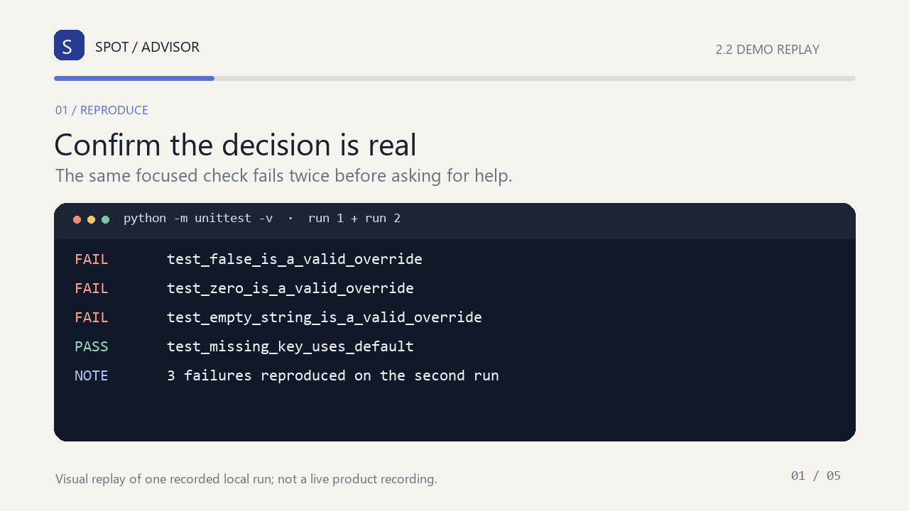

# Spot Advisor demo



This walkthrough starts with a real failing check, previews the exact v2 packet without calling a model, optionally asks one live consultation, then verifies the change. The fixture is copied under the ignored tmp directory so you can edit it without changing this repository.

## PowerShell

Run from the repository root:

```powershell
$repo = (git rev-parse --show-toplevel).Trim()
$demo = Join-Path $repo 'tmp\spot-advisor-demo'
New-Item -ItemType Directory -Force $demo | Out-Null
Copy-Item (Join-Path $repo 'demo\fixture\*') $demo
Push-Location $demo
python -m unittest -v
python -m unittest -v
Pop-Location
```

Both test runs are expected to fail on the explicit False override. Then preview the packet from the same temporary directory:

```powershell
$advisor = Join-Path $repo 'skills\advisor\scripts\ask_expert.py'
$state = Join-Path $repo 'demo\state.json'
$session = Join-Path $demo 'advisor-session.json'
Push-Location $demo
python $advisor --transport codex --state-file $state --session-file $session --trigger two_failed_checks --question 'The focused check fails when an explicit False override is replaced by the default. Which lookup change preserves the missing-key fallback, and what should I verify?' --snippet settings.py:1-3 --preview
```

The preview command sends nothing. To make one real Codex consultation, rerun that command without --preview. It uses the logged-in Codex route and may consume your subscription usage. The reply is advice, not an automatic edit: update settings.py in the temporary directory, then run python -m unittest -v again. The acceptance checks cover False, 0, an empty string, and a missing key.

## macOS / Linux

Run from the repository root:

```sh
repo="$(git rev-parse --show-toplevel)"
demo="$repo/tmp/spot-advisor-demo"
mkdir -p "$demo"
cp "$repo"/demo/fixture/* "$demo"/
cd "$demo"
python -m unittest -v
python -m unittest -v
python "$repo/skills/advisor/scripts/ask_expert.py" --transport codex --state-file "$repo/demo/state.json" --session-file "$demo/advisor-session.json" --trigger two_failed_checks --question "The focused check fails when an explicit False override is replaced by the default. Which lookup change preserves the missing-key fallback, and what should I verify?" --snippet settings.py:1-3 --preview
```

For a live call, remove --preview. The Codex CLI must already be signed in. Apply the advisor's suggested change in the temporary directory and rerun the unittest command.

## Recording notes

The sample is deliberately small: settings.py uses a truthiness fallback, and the tests show why a configured False, 0, or empty string is different from a missing key. The expected fix is an explicit key-presence check, but the demo must show the actual advisor reply and the final test result from the recorded run. Keep account names, local paths, session files, request IDs, and credentials out of any recording. Do not present a stored example answer as a live consultation.

## Rebuild the visual replay

The checked-in English and Chinese GIFs are generated from the sanitized replay data. To rebuild them and refresh the Pages asset bundle from the repository root:

```sh
python -m pip install Pillow
python demo/render_demo.py
python site/build.py
```

Pillow is only needed to regenerate the GIFs. Running the offline preview and the fixture walkthrough above does not require it.

The Chinese replay also needs a system CJK font, such as Microsoft YaHei on Windows or Noto Sans CJK on Linux.
